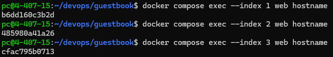
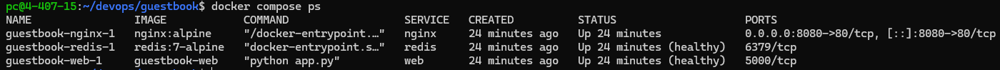

# 7주차 Docker Compose 실습

## 1. Docker Compose 실행

Docker Compose를 이용해 Nginx, Flask Web, Redis 컨테이너를 실행하였다.

`docker compose ps` 명령어로 실행 상태를 확인하였으며, Web과 Redis가 모두 Healthy 상태인 것을 확인하였다.

## 2. Healthcheck

Redis와 Web 서비스에 Healthcheck를 적용하여 서비스가 정상적으로 요청을 처리할 준비가 되었는지 확인하였다.

`condition: service_healthy`를 사용하여 의존 서비스가 정상 상태가 된 후 다음 서비스를 시작하도록 설정하였다.

## 3. Nginx 리버스 프록시

Nginx를 통해 8080 포트로 들어온 요청을 Flask Web 서비스의 5000 포트로 전달하도록 구성하였다.

## 4. Web 컨테이너 확장

`docker compose up -d --scale web=3` 명령어를 실행하여 Flask Web 컨테이너를 1개에서 3개로 확장하였다.

`docker compose ps` 명령어로 Web 컨테이너 3개가 모두 Healthy 상태인 것을 확인하였다.

각 Web 컨테이너의 호스트명을 확인한 결과 다음과 같이 서로 다르게 출력되었다.

- guestbook-web-1: `b6dd160c3b2d`
- guestbook-web-2: `485980a41a26`
- guestbook-web-3: `cfac795b0713`

이를 통해 서로 다른 Web 컨테이너 3개가 실행 중임을 확인하였다.

Nginx를 통해 `http://localhost:8080`으로 접속했을 때 방명록 화면이 정상적으로 표시되었으며, Redis에 저장된 기존 글도 유지되었다.

### Scale 실습 캡처






## 5. Docker 볼륨 데이터 유지 비교

Docker Compose의 `down`과 `down -v` 명령어가 Redis 데이터에 미치는 차이를 비교하였다.

### 5-1. docker compose down

```bash
docker compose down
docker compose up -d
```

방명록에 글을 작성한 후 `docker compose down`으로 컨테이너와 네트워크를 삭제하고 다시 실행하였다.

브라우저에서 확인한 결과, 기존에 작성한 방명록 글이 그대로 유지되었다.

이는 `docker compose down` 명령어가 컨테이너와 네트워크는 삭제하지만 Redis 데이터를 저장하는 이름 있는 볼륨(`guestbook_redis-data`)은 삭제하지 않기 때문이다.

### 5-2. docker compose down -v

```bash
docker compose down -v
docker compose up -d
```

`docker compose down -v`는 컨테이너와 네트워크뿐만 아니라 Docker Compose가 생성한 이름 있는 볼륨까지 삭제한다.

따라서 다시 컨테이너를 실행하면 새로운 Redis 볼륨이 생성되고, 기존 방명록 글은 사라질 것으로 예상된다.

### 5-3. 비교 결과

| 구분 | docker compose down | docker compose down -v |
|---|---|---|
| 컨테이너 삭제 | O | O |
| 네트워크 삭제 | O | O |
| Redis 볼륨 삭제 | X | O |
| 방명록 데이터 | 유지 확인 | 삭제 확인 |

### 5-4. 실습을 통해 알게 된 점

Docker 컨테이너를 삭제하더라도 별도로 생성한 볼륨을 유지하면 데이터를 보존할 수 있다는 것을 확인하였다.

또한 `-v` 옵션을 사용하면 볼륨까지 삭제되므로 데이터 초기화가 필요한 경우에 사용해야 하며, 중요한 데이터가 저장되어 있다면 주의해야 한다.

## 6. 환경 변수 보안

Redis 비밀번호를 `.env` 파일에 저장하고, `.gitignore`와 `.dockerignore`에 `.env`를 등록하였다.

`.env` 파일을 GitHub에 올리지 않는 이유는 비밀번호와 같은 민감한 설정 정보가 외부에 공개되는 것을 방지하기 위해서이다.
