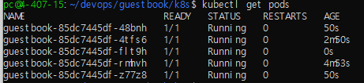

# Week 10 - 쿠버네티스 배포와 서비스

## 1. 실습 목표

- Deployment를 이용한 방명록 애플리케이션 배포
- Service를 이용한 Pod 접근 및 로드밸런싱
- Replica 확장 및 Pod 자동 복구 확인
- Rolling Update 및 Rollback 실습

## 2. Deployment 및 Service 생성

guestbook/k8s 폴더에 deployment.yaml과 service.yaml을 작성하였다.

kubectl apply -f guestbook/k8s/deployment.yaml
kubectl apply -f guestbook/k8s/service.yaml

Deployment를 통해 방명록 Pod를 생성하고, NodePort Service를 통해 브라우저에서 방명록에 접속하였다.

## 3. Replica 확장

kubectl scale deployment guestbook --replicas=5
kubectl get pods

Pod의 개수를 5개로 확장하고 모든 Pod가 Running 상태인 것을 확인하였다.

## 4. Service 로드밸런싱

Service를 통해 /healthz에 여러 번 요청을 보내 서로 다른 Pod의 hostname이 반환되는 것을 확인하였다.

확인된 Pod hostname:

- guestbook-85dc7445df-lqz5b
- guestbook-85dc7445df-c94bk
- guestbook-85dc7445df-rmm5z
- guestbook-85dc7445df-sgsv6

이를 통해 Service가 여러 Pod에 요청을 분산시키는 것을 확인하였다.

## 5. Pod 강제 삭제 및 자동 복구

kubectl delete pod guestbook-85dc7445df-c94bk --grace-period=0 --force

기존 Pod를 강제로 삭제하였으며, 새로운 Pod인 guestbook-85dc7445df-kxw59가 자동으로 생성되었다.

kubectl get deployment guestbook

결과: READY 5/5, UP-TO-DATE 5, AVAILABLE 5

Deployment가 설정된 Replica 수를 유지하도록 자동으로 복구하는 것을 확인하였다.

## 6. Rolling Update

Dockerfile의 방명록 제목에 v3를 추가하고 테마 색상을 초록색으로 변경하였다.

docker build -t ghcr.io/yejun5380/guestbook:v3 .
docker push ghcr.io/yejun5380/guestbook:v3
minikube image load ghcr.io/yejun5380/guestbook:v3

kubectl set image deployment/guestbook web=ghcr.io/yejun5380/guestbook:v3
kubectl rollout status deployment/guestbook

기존 v2 Pod가 새로운 v3 Pod로 순차적으로 교체되었으며, 업데이트 중에도 /healthz에서 HTTP 200 OK 응답이 반환되는 것을 확인하였다.

교안에서는 v1에서 v2로 업데이트하지만, 기존 v1 이미지를 사용할 수 없어 v2에서 v3로 업데이트하였다.

## 7. Rollout History

kubectl rollout history deployment/guestbook

롤링 업데이트 후 Revision 1, 2, 3이 확인되었다.

## 8. Rollback

kubectl rollout undo deployment/guestbook
kubectl rollout status deployment/guestbook
kubectl get deployment guestbook -o wide

v3에서 이전 버전인 v2로 정상적으로 롤백되었으며, Pod 5개가 Running 상태인 것을 확인하였다.

롤백 후 Revision 1, 3, 4가 확인되었다.

## 9. 실습 결과

Deployment와 Service를 이용하여 방명록 애플리케이션을 배포하였다. Replica 확장, 로드밸런싱, Pod 자동 복구, 롤링 업데이트 및 롤백을 직접 실습하면서 쿠버네티스가 애플리케이션의 상태를 관리하는 방법을 이해하였다.
