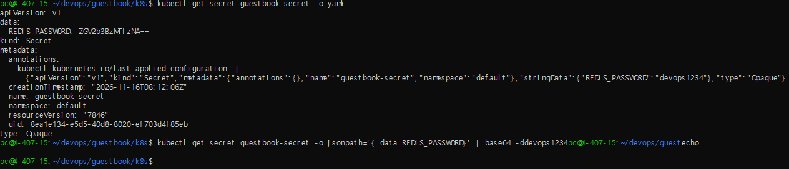
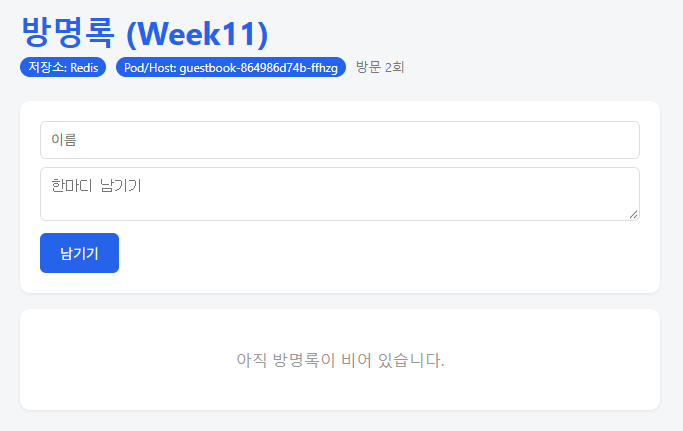
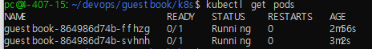
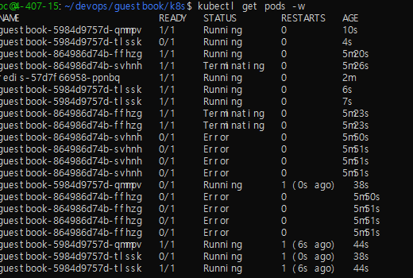

# Week 11 - 쿠버네티스 설정과 상태 점검

## 1. 실습 목표

- ConfigMap과 Secret을 이용한 설정 분리
- Redis 배포 및 방명록 연동
- Readiness Probe와 Liveness Probe의 차이 이해
- 쿠버네티스 장애 확인 및 복구 방법 학습

## 2. ConfigMap 및 Secret 생성

ConfigMap에 방명록 제목, 테마 색상, Redis 주소와 포트를 설정하였다.
Secret에는 Redis 비밀번호를 저장하였다.

실행 명령어:

```bash
kubectl apply -f configmap.yaml
kubectl apply -f secret.yaml
kubectl get cm,secret
```

### Secret base64 디코딩

```bash
kubectl get secret guestbook-secret -o yaml
kubectl get secret guestbook-secret -o jsonpath='{.data.REDIS_PASSWORD}' | base64 -d
```



Secret의 값은 base64로 인코딩되어 있지만 암호화된 것은 아니다.
base64 -d 명령어를 사용하면 원래 비밀번호를 확인할 수 있으므로 Secret 파일을 GitHub에 그대로 올리면 안 된다.

## 3. Redis 배포 및 방명록 연결

```bash
kubectl apply -f redis.yaml
kubectl rollout status deployment/redis
kubectl apply -f deployment.yaml
kubectl rollout status deployment/guestbook
kubectl get pods,svc
```

Redis Deployment와 ClusterIP Service를 생성하였다.
envFrom을 사용하여 ConfigMap과 Secret의 값을 방명록 컨테이너에 환경변수로 전달하였다.

기존에 직접 제작한 ghcr.io/yejun5380/guestbook:v3 이미지를 사용하였으며, 방명록 Pod 2개와 Redis Pod 1개를 실행하였다.

## 4. ConfigMap 변경 실습

방명록 제목을 "방명록 (Week11)"로 변경하고 테마 색상을 파란색(#2563eb)으로 변경하였다.

```bash
kubectl apply -f configmap.yaml
kubectl rollout restart deployment/guestbook
kubectl rollout status deployment/guestbook
```



ConfigMap을 수정해도 실행 중인 컨테이너의 환경변수는 자동으로 변경되지 않는다.
따라서 Deployment를 재시작하여 변경된 설정을 적용하였다.

## 5. Readiness Probe 실패 실습

Redis를 중지하여 방명록이 요청을 처리할 준비가 되지 않은 상황을 만들었다.

```bash
kubectl scale deployment redis --replicas=0
kubectl get pods -w
```



Readiness Probe는 애플리케이션이 요청을 받을 준비가 되었는지 확인한다.
Redis 연결이 끊어지면 /readyz에서 HTTP 503 오류가 발생한다.
Readiness 검사에 실패한 Pod는 READY가 0/1로 변경되며 서비스의 요청 전달 대상에서 제외된다.
컨테이너 자체를 재시작하지는 않는다.

Redis를 다시 실행하여 정상 상태로 복구하였다.

```bash
kubectl scale deployment redis --replicas=1
kubectl get pods
```

## 6. Liveness Probe 실패 실습

Liveness Probe의 경로를 /healthz에서 존재하지 않는 /devops로 변경하였다.

```bash
kubectl patch deployment guestbook -p '{"spec":{"template":{"spec":{"containers":[{"name":"web","livenessProbe":{"httpGet":{"path":"/devops","port":5000},"periodSeconds":5,"failureThreshold":2}}]}}}}'
kubectl get pods -w
```



잘못된 경로로 인해 Liveness 검사에 실패하면서 컨테이너가 반복적으로 재시작되었다.
RESTARTS가 2까지 증가하는 것을 확인하였다.

정상적인 deployment.yaml을 다시 적용하여 복구하였다.

```bash
kubectl apply -f deployment.yaml
kubectl rollout status deployment/guestbook
kubectl get pods
```

## 7. 트러블슈팅 3단계

1. kubectl get pods
   - READY, STATUS, RESTARTS를 확인하여 어떤 문제가 발생했는지 파악한다.

2. kubectl describe pod <Pod 이름>
   - Events 부분을 확인하여 이미지 오류, 설정 오류, Probe 실패 등의 원인을 찾는다.

3. kubectl logs <Pod 이름>
   - 애플리케이션 로그를 확인하여 실제 오류를 찾는다.
   - 반복적으로 재시작되는 경우 --previous 옵션으로 이전 컨테이너의 로그를 확인한다.

## 8. Secret 보안 관리

- 실제 secret.yaml은 .gitignore에 추가하여 GitHub 업로드를 방지하였다.
- secret.yaml.example 파일을 생성하고 비밀번호를 CHANGE_ME로 변경하였다.

## 9. 실습 결과

ConfigMap과 Secret을 활용하여 애플리케이션 설정을 분리하고 Redis와 방명록을 연결하였다.
Readiness Probe는 요청 전달을 차단하고 Liveness Probe는 컨테이너를 재시작한다는 차이를 실습을 통해 이해하였다.
또한 문제가 발생했을 때 Pod 상태, Events, 로그 순서로 확인하는 방법을 학습하였다.
