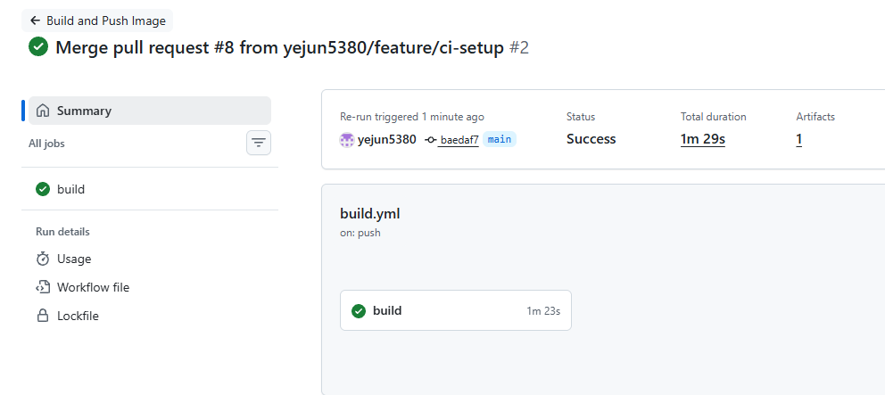
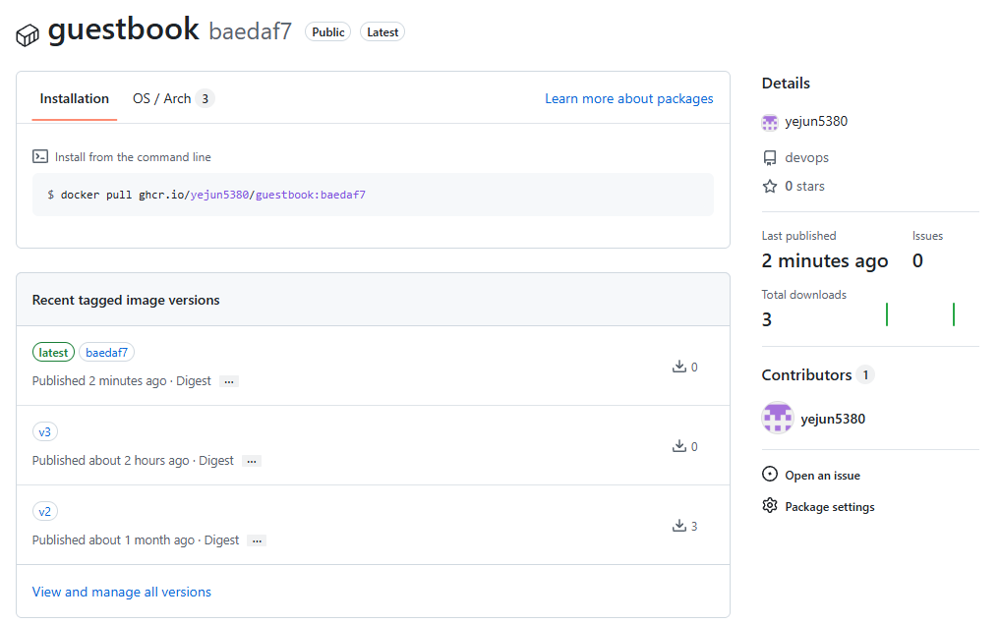
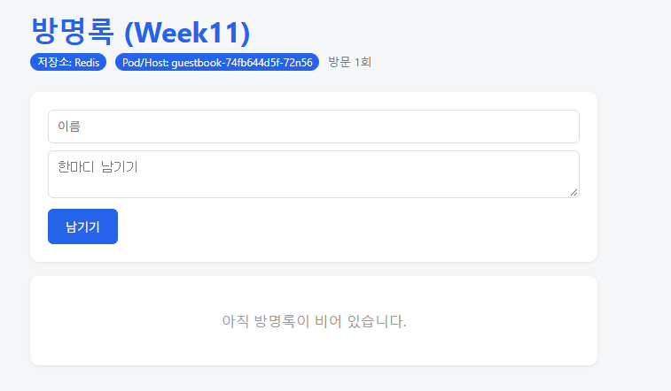
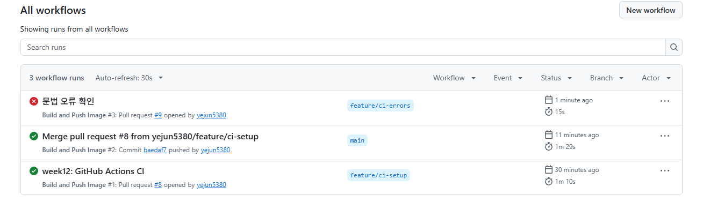
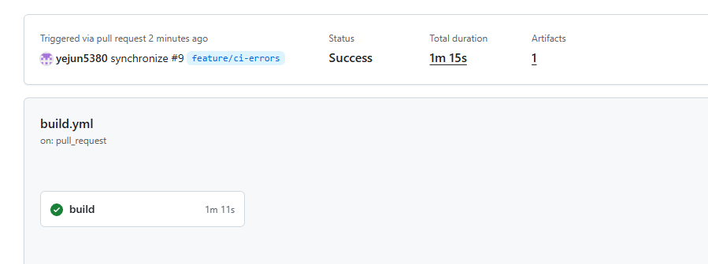
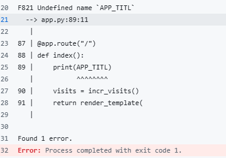
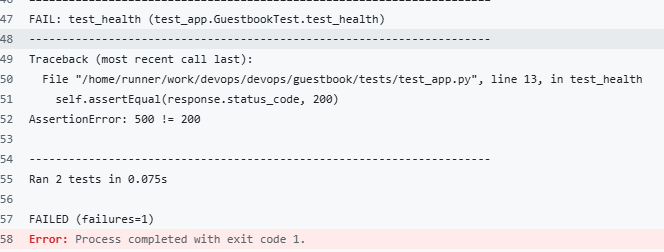

# 12주차 - GitHub Actions

## 1. 실습 목표

- GitHub Actions를 활용한 CI 환경 구성
- 코드 검사, 테스트, Docker 이미지 자동 빌드
- GHCR 이미지 게시 및 Kubernetes 배포
- 브랜치 보호 규칙을 통한 오류 코드 머지 방지

## 2. GitHub Actions CI 구성

.github/workflows/build.yml 파일을 작성하여
코드 검사, 앱 동작 테스트, Docker 이미지 빌드를
자동으로 수행하도록 구성하였다.

- Python 3.12 환경 구성
- Ruff를 이용한 코드 검사
- unittest를 이용한 앱 동작 테스트
- Docker Buildx를 이용한 이미지 빌드
- main 브랜치에서 GHCR 이미지 자동 게시

PR에서는 검사와 빌드만 수행하고,
main에 머지되면 이미지를 GHCR에 게시하도록 설정하였다.

## 3. GHCR 이미지 자동 게시

GitHub Actions에서 생성한 Docker 이미지를
ghcr.io/yejun5380/guestbook에 게시하였다.

latest 태그와 커밋 해시 태그를 사용하여
이미지 버전을 확인할 수 있도록 구성하였다.

이미지 게시 과정에서 패키지 쓰기 권한 오류가 발생했으나,
GHCR의 Manage Actions access에서 devops 저장소에
Write 권한을 부여하여 해결하였다.

## 4. Kubernetes 배포

CI가 생성한 이미지를 Kubernetes Deployment에 적용하였다.

    kubectl set image deployment/guestbook web=ghcr.io/yejun5380/guestbook:baedaf7
    kubectl rollout status deployment/guestbook
    kubectl get pods

롤링 업데이트가 정상적으로 완료되었으며,
새로운 Pod 2개가 Running 상태인 것을 확인하였다.
브라우저에서도 방명록이 정상적으로 실행되었다.

## 5. 오류 발생 및 수정 실습

### 5-1. 문법 오류

app.py에 def broken(: 코드를 추가하여
문법 오류를 발생시켰다.

GitHub Actions의 코드 검사 단계에서 오류를 발견하고
이미지 빌드가 중단되는 것을 확인하였다.

오류 코드를 삭제한 후 다시 푸시하여
모든 검사가 정상적으로 통과하는 것을 확인하였다.

### 5-2. 린트 오류

index 함수에 print(APP_TITL)을 추가하여
변수 이름 오타를 발생시켰다.

Python compileall 문법 검사는 통과하였으나,
Ruff 검사에서 F821 Undefined name 오류가 발생하였다.

문법 검사만으로 발견하기 어려운 오류를
린트 검사로 확인할 수 있었다.

### 5-3. 앱 동작 테스트 오류

healthz 함수의 HTTP 응답 코드를 200에서 500으로 변경하였다.

코드 검사는 통과하였지만 앱 동작 테스트에서
AssertionError: 500 != 200 오류가 발생하였다.

응답 코드를 다시 200으로 수정하여
모든 테스트를 통과한 후 PR을 머지하였다.

## 6. main 브랜치 보호 설정

GitHub Rulesets에서 protect-main 규칙을 생성하였다.

- Enforcement status: Active
- Target: 기본 브랜치(main)
- Require a pull request before merging
- Require status checks to pass: build
- Block force pushes

main 브랜치에 직접 push를 시도하였을 때
GH013 오류와 함께 푸시가 차단되는 것을 확인하였다.

또한 feature/broken-test 브랜치에 문법 오류를 추가하고
PR을 생성하여 검사 실패 시 머지 버튼이
비활성화되는 것을 확인하였다.

오류를 수정한 후 모든 검사가 통과하였으며,
Squash Merge를 통해 main 브랜치에 반영하였다.

## 7. 실습 결과 및 느낀 점

이번 실습을 통해 GitHub Actions를 활용하면
코드를 변경할 때마다 자동으로 검사하고
Docker 이미지를 생성할 수 있다는 것을 알게 되었다.

문법 검사, 린트 검사, 앱 동작 테스트는
각각 발견할 수 있는 오류의 종류가 다르며,
브랜치 보호 규칙을 함께 사용하면 오류가 있는 코드가
main 브랜치에 합쳐지는 것을 방지할 수 있다.

현재는 이미지 생성까지 자동화되어 있으며,
Kubernetes 배포는 kubectl 명령어로 직접 진행하였다.
다음 단계에서는 배포 자동화를 학습할 예정이다.
